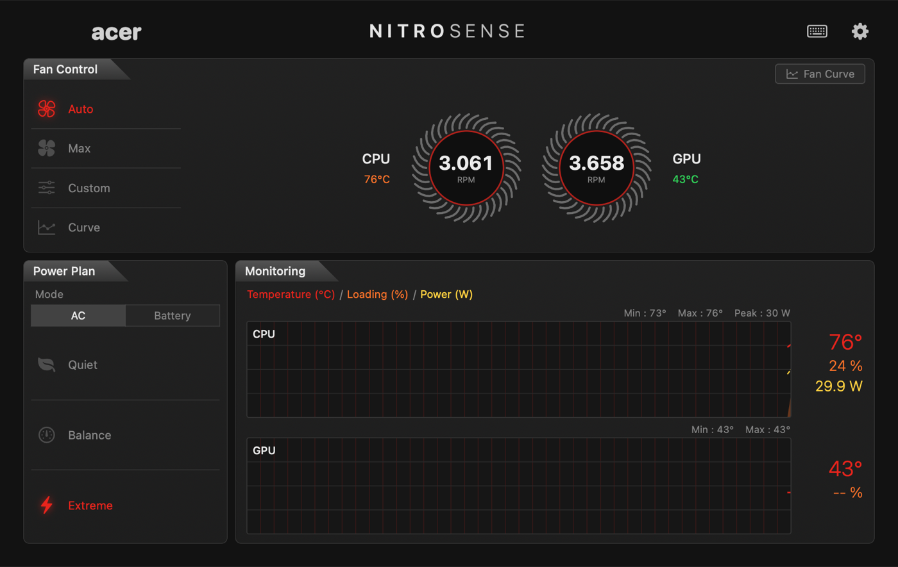
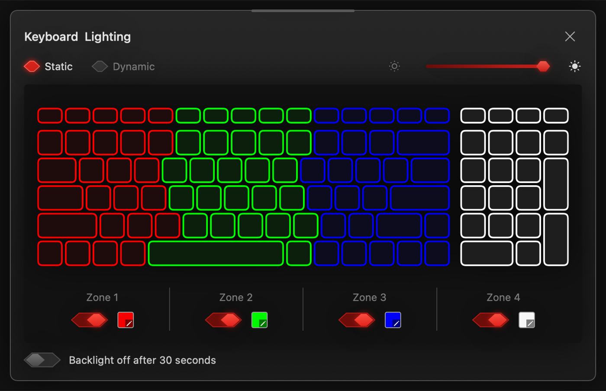
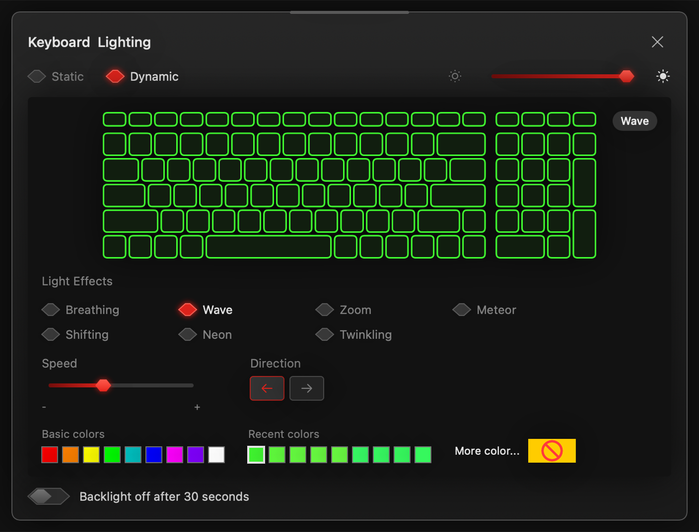
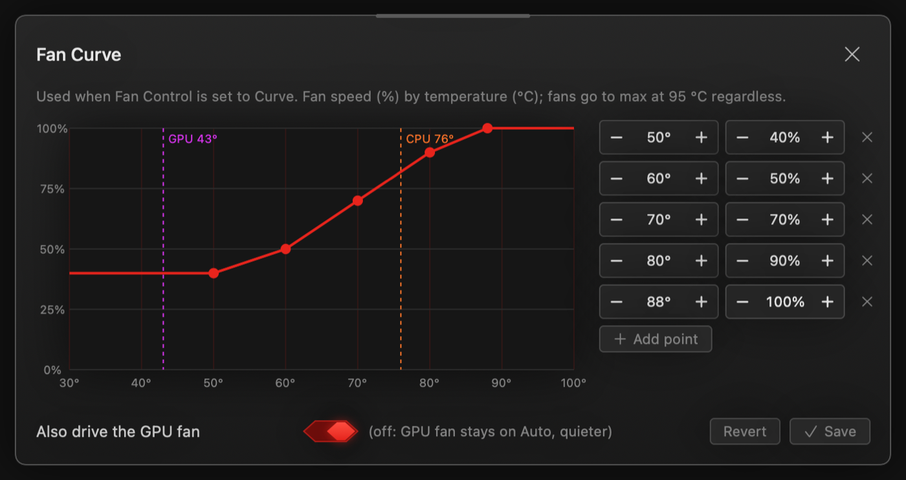
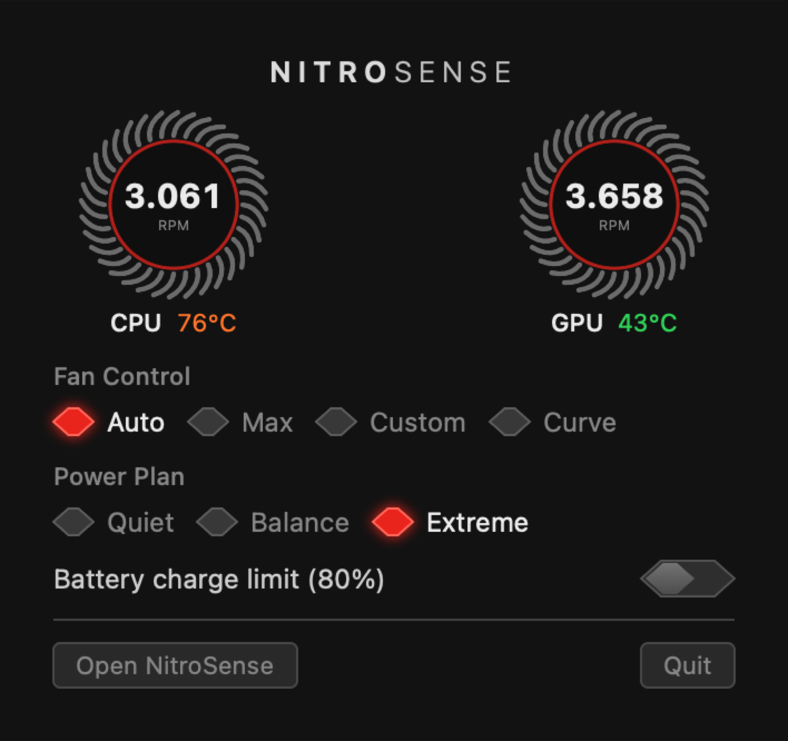
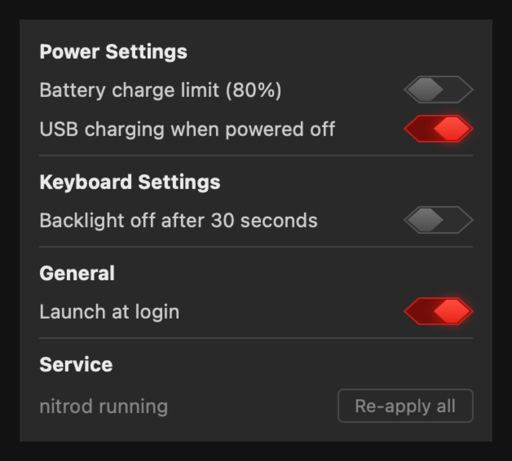
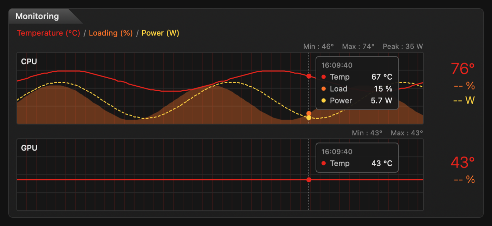

# NitroSense for macOS

A native macOS take on Acer **NitroSense** for Hackintosh laptops: fan control, power plan,
4-zone RGB keyboard, battery charge limit and live monitoring, from a menu bar app that looks
like the Windows original.

> [!IMPORTANT]
> **Works perfectly on the Acer Nitro 5 AN515-57 with macOS 26 (Tahoe)**, tested on macOS 26.7.1
> with OpenCore 1.0.9.
>
> **Only tested on the AN515-57.** The embedded controller (EC) register map, ACPI paths and
> WMI calls were verified against this model's firmware only. Other Nitro / Predator models may
> use different registers. Read the [safety notes](#safety) before trying it on anything else.



## Features

- **Fan Control**: Auto, Max, Custom (separate CPU / GPU duty) and a temperature **Curve** with an
  editor. The curve drives the CPU fan by default; the GPU fan can follow it too.
- **Failsafe**: both fans go to max at 95 °C (configurable) until things cool down 10 °C, in
  every fan mode. Fans return to Auto whenever the daemon stops.
- **Power Plan**: Quiet / Balance / Extreme (the firmware operating mode).
- **Keyboard Lighting**: 4-zone static colours with per-zone on/off, dynamic effects
  (Breathing, Wave, Zoom, Meteor, Shifting, Neon, Twinkling) with speed, direction and colour,
  brightness, and "backlight off after 30 seconds".
- **Battery charge limit (80 %)**, **USB charging when powered off**.
- **Monitoring**: CPU / GPU temperature, CPU load and CPU package power (W) with 5-minute graphs
  and a hover readout; whole-machine draw while on battery.
- The **NitroSense key** above the keyboard opens the window (press again to close it).
- **Menu bar** readout of CPU · GPU temperature with quick controls. The app starts in the
  background at login; open it from the menu bar, Launchpad or Finder.
- Settings live in a root daemon and are **re-applied at boot and after sleep** (the firmware
  forgets PSEE, the keyboard colours and some modes on every boot).
- `nitroctl` command-line tool for everything above.

| Keyboard Lighting (static) | Keyboard Lighting (dynamic) |
| --- | --- |
|  |  |

| Fan Curve | Menu bar | Settings |
| --- | --- | --- |
|  |  |  |



## How it works

```
NitroSense.app ─┐                      ┌─ EC RAM (0xFE0B0800, read / whitelisted writes)
nitroctl ───────┼─ /var/run/nitrod.sock ─ nitrod (root) ─ NitroEC.kext ─ SSDT-NITRO ─┤
                │    (JSON, admin group)                                               └─ WMI WMBH / WMBE (firmware)
                └─ (nitroctl can also talk to the kext directly with sudo)
```

| Part | What it does |
| --- | --- |
| `ACPI/SSDT-NITRO.dsl` | Adds `\_SB.NTRO` (`_HID NTRO0001`, Darwin only) with methods to read/write EC RAM and call the firmware WMI methods `WMBH` (gaming) and `WMBE` (battery health). Also gives VoodooPS2 an `RMCF` that maps the NitroSense key (PS/2 `e0 75`) to F20, which the app catches as a hotkey. |
| `Kext/` NitroEC.kext | Matches `NTRO0001` and exposes a user client: read byte, dump, and **whitelisted** writes / WMI calls (only the registers and opcodes listed below; root only). Puts the fans back to Auto when unloaded. |
| `Daemon/` nitrod | Root LaunchDaemon. Keeps `config.json`, re-applies it at start / wake, runs the fan curve and failsafe every 2 s, reads CPU power from `powermetrics`, serves the app over a Unix socket. |
| `App/` NitroSense.app | SwiftUI app styled after NitroSense 3. Talks only to nitrod, needs no root. |
| `CLI/` nitroctl | Status, dumps, and every control from the terminal. |

AN515-57 EC map used (offsets into EC RAM):

| Function | Offset | Values |
| --- | --- | --- |
| Flags | `0x03` | bit 4 PSEE (gaming software present, required for fan control), bit 6 80 % charge limit |
| Keyboard 30 s timeout | `0x06` | `1E` on / `00` off |
| USB power-off charging | `0x08` | `0F` on / `1F` off |
| CPU / GPU fan RPM | `0x13` / `0x15` | 16-bit little endian |
| Keyboard effect, speed, brightness, direction, colour | `0x17`–`0x1E` | |
| GPU / CPU fan mode | `0x21` / `0x22` | `10/20/30` and `04/08/0C` = auto / max / manual |
| Operating mode | `0x2C` | 0 quiet, 1 default, 4 extreme |
| CPU / GPU manual duty | `0x37` / `0x3A` | 20–100 % |
| Zone colours | `0x3C`–`0x47` | R, G, B × 4 |
| CPU / GPU temperature | `0xB0` / `0xB6` | °C |

Firmware calls: `WMBH 0x05` + `0x02 [08 0 0 0 0 0F]` enables the 4-zone keyboard, `0x06` zone
colour, `0x14` effect, `0x16 [0B, mode]` operating mode; `WMBE 0x14 / 0x15` read / set the charge
limit.

## Requirements

- An **Acer Nitro 5 AN515-57** Hackintosh (Intel 11th gen) booting with **OpenCore**, with the
  OpenCore EFI on `disk0s1` (override with `EFI_DISK=diskXsY`).
  My full EFI and kexts for this model are in
  [Hackintosh-Acer-Nitro-5-AN515-57](https://github.com/ptnzzn/Hackintosh-Acer-Nitro-5-AN515-57).
- macOS 15.5 or newer (tested on macOS 26.7.1).
- SIP configured to allow unsigned kexts (`csr-active-config` with `CSR_ALLOW_UNTRUSTED_KEXTS`),
  as on most Hackintoshes that load third-party kexts from `/Library/Extensions`.
- Firmware WMI device at `\_SB.PC00.WMID` and EC RAM mapped at `0xFE0B0800` (true for the
  AN515-57 BIOS).

## Install (release build)

1. Download `NitroSense-macOS-<version>.zip` from
   [Releases](https://github.com/ptnzzn/NitroSense-macOS/releases) and unzip it.
2. Remove the quarantine flag and run the installer:

   ```bash
   cd NitroSense-macOS-<version>
   xattr -dr com.apple.quarantine .
   ./Scripts/install-all.sh
   ```

   It backs up `EFI/OC/config.plist`, copies `SSDT-NITRO.aml` and adds it to `ACPI > Add`,
   installs `NitroEC.kext` into `/Library/Extensions`, installs the `nitrod` LaunchDaemon and
   copies `NitroSense.app` to `/Applications`.
3. If macOS asks, allow the kext in **System Settings → Privacy & Security**, then **reboot**.
4. Check it:

   ```bash
   ./build/nitroctl status
   ./Scripts/check-reapply.sh
   ```

The app registers itself to start at login (in the background). Turn that off in the gear menu.

## Build from source

Needs Xcode (or the Command Line Tools with the macOS SDK) and
[`iasl`](https://github.com/acpica/acpica) (point `IASL=` at it, default `.tools/iasl`).

```bash
make                    # SSDT, kext, nitroctl, nitrod, NitroSense.app into build/
make release VERSION=1.0.0   # zip into dist/
./Scripts/install-all.sh
```

Individual steps: `sudo ./Scripts/install.sh` (SSDT + kext), `sudo ./Scripts/install-daemon.sh`,
`./Scripts/install-app.sh`.

## Command line

```bash
nitroctl status                                  # sensors, fans, modes, keyboard
nitroctl watch 1                                 # live status
sudo nitroctl fan auto | max | manual 60         # [cpu|gpu|all]
sudo nitroctl mode quiet | default | extreme
sudo nitroctl battery limit on | off | status
sudo nitroctl led zone all FF0000                # also: effect wave 5 00FFFF dir1, brightness 50, off, restore
sudo nitroctl usb-charge on | off
sudo nitroctl kb-timeout on | off
nitroctl daemon status                           # talk to nitrod (no sudo, admin group)
nitroctl daemon set '{"fan":{"mode":"curve"},"led":{"brightness":60}}'
```

Writes made with `sudo nitroctl` are not saved; use `nitroctl daemon set` (or the app) to keep a
setting across reboots.

## Uninstall

```bash
sudo ./Scripts/uninstall-daemon.sh   # stops nitrod, fans back to Auto
sudo ./Scripts/uninstall.sh          # removes the kext and the SSDT entry (config.plist is backed up)
```

Turn off "Launch at login" in the gear menu, quit the app from the menu bar and delete
`/Applications/NitroSense.app`. Settings stay in `/Library/Application Support/NitroSense`.

## Safety

- This writes to your laptop's embedded controller. The kext only allows a fixed whitelist of
  registers, values and WMI opcodes known to be safe on the AN515-57, and refuses everything else.
- On a different model the same offsets may control something else. **Do not install it on
  another laptop** unless you have checked its DSDT / EC layout yourself.
- If the kext misbehaves, boot with Shift (Safe Mode) and run `sudo ./Scripts/uninstall.sh`, or
  disable `SSDT-NITRO.aml` in your OpenCore `config.plist`.
- Provided as is, without warranty.

## Known limitations

- On macOS the power plan does not change CPU power limits (they are applied by Windows-only
  NVIDIA and Intel DPTF drivers); it mainly changes the EC's automatic fan behaviour.
- CPU power is the Intel package (cores + iGPU + system agent) from `powermetrics`; there is no
  reading for the NVIDIA GPU.
- In Custom mode the GPU fan does not spin below roughly 3,700 RPM.

## Credits

The EC map and WMI calls were worked out from the AN515-57 ACPI tables with help from these
Linux projects:

- [0x7375646F/Linuwu-Sense](https://github.com/0x7375646F/Linuwu-Sense) (battery health WMI, RGB, fans)
- [JafarAkhondali/acer-predator-turbo-and-rgb-keyboard-linux-module](https://github.com/JafarAkhondali/acer-predator-turbo-and-rgb-keyboard-linux-module) (4-zone keyboard enable sequence)
- [MehmetCanWT/OpeNitro](https://github.com/MehmetCanWT/OpeNitro) (EC fan registers)
- [negihimanshu015/NitroSense-Linux](https://github.com/negihimanshu015/NitroSense-Linux) (WMBH protocol on the AN515-57)
- [Packss/Linux-NitroSense](https://github.com/Packss/Linux-NitroSense)
- [OrnelasD-Rogers/acer-nitro-ec](https://github.com/OrnelasD-Rogers/acer-nitro-ec)

NitroSense and Acer are trademarks of Acer Inc. This project is not affiliated with Acer.

## License

[GPL-3.0](LICENSE)
